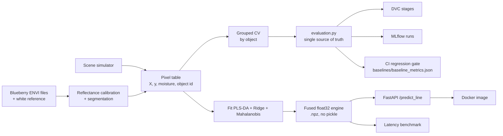
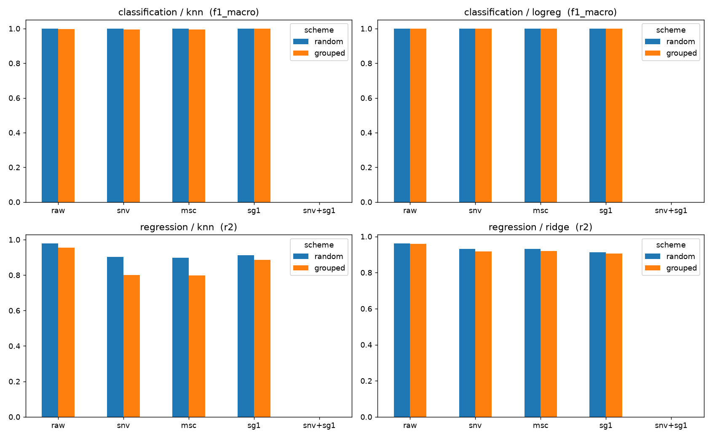
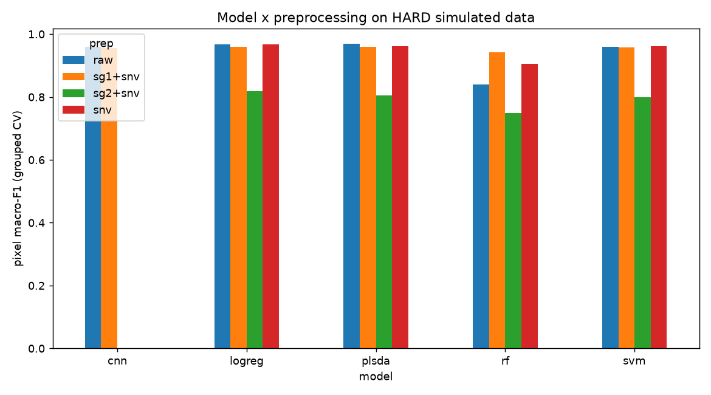
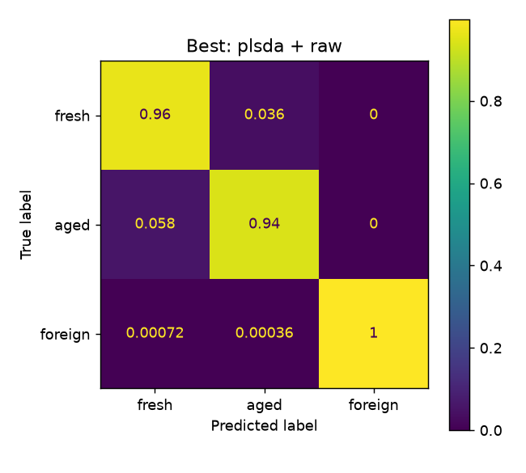
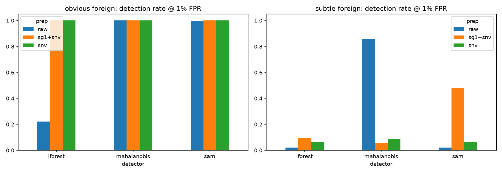
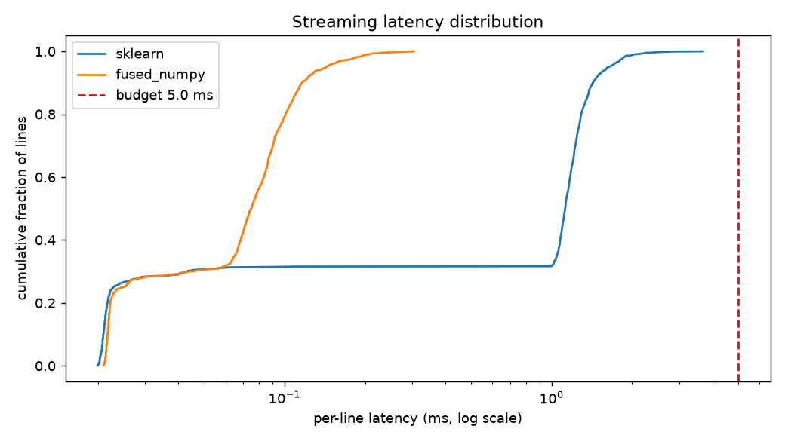
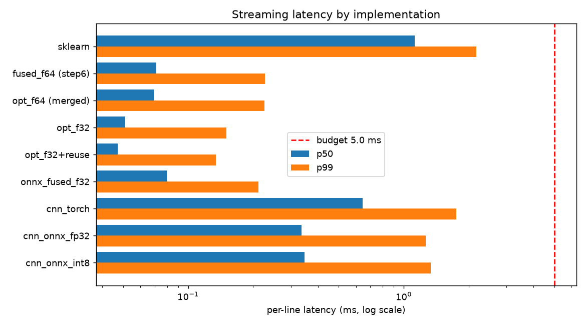
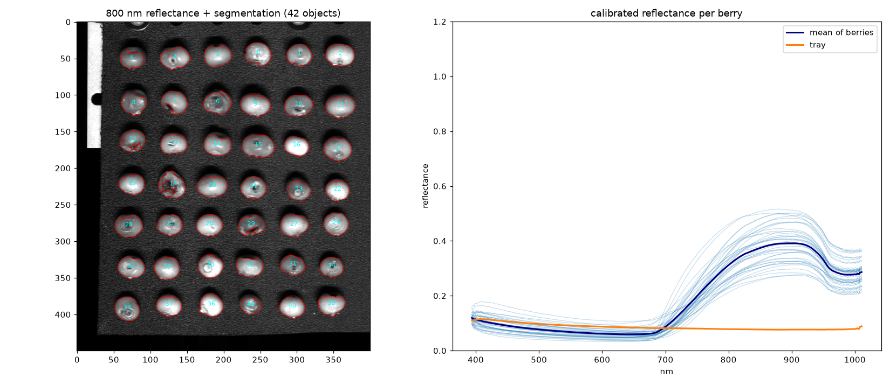
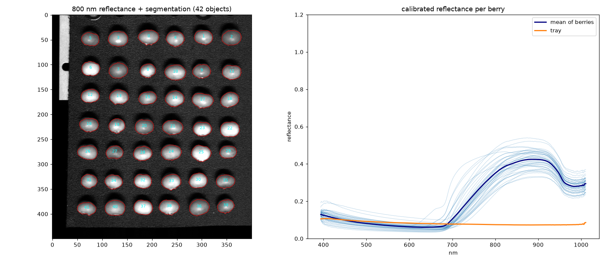

<h1 align="center">HSI Food Inspector</h1>

<p align="center">
  End-to-end machine learning for <b>hyperspectral food inspection</b>:<br>
  leak-free validation, three inspection tasks, a real-time streaming engine,<br>
  MLOps with a regression gate in CI, and a validation on real blueberry data.
</p>

<p align="center">
  <a href="https://github.com/baiheng2012/hsi-food-inspector/actions"></a>
  
  
  
  
  
</p>

---

## Overview

Inline food inspection runs on a conveyor belt: a pushbroom hyperspectral camera delivers one line of
spectra at a time, and the software must classify, quantify and flag foreign material before the next
line arrives. This project builds that whole path and treats the engineering around the model as
seriously as the model itself.

| Area | What was built |
|---|---|
| **Validation** | All cross-validation is grouped by physical object, with an assertion that no object appears in both train and test. Leakage is measured, not assumed. |
| **Tasks** | 4-class pixel classification, moisture regression, and foreign-object detection trained on *normal* food only. |
| **Real-time** | Line-by-line streaming engine, fused into plain matrix operations, with p50/p95/p99 latency against a stated budget. |
| **MLOps** | DVC pipeline, MLflow tracking, and a CI gate that fails when metrics regress against a committed baseline. |
| **Serving** | FastAPI service, Docker image built reproducibly from `uv.lock`, GitHub Actions workflow. |
| **Real data** | Reflectance calibration, segmentation and berry-level defect detection on a public blueberry dataset. |

> **Read this first: data.** Sections 1 to 5 use a physics-inspired **simulator** (NIR 900-1700 nm, 100 bands,
> multiplicative scatter, baseline slope, sensor noise). They show how the methods behave under
> controlled difficulty, not how they would perform in production. Section 6 repeats the detection
> experiment on **real** hyperspectral data (one Good and one Bad file, 84 berries) and the conclusions
> from simulation did **not** all transfer. The 5 ms/line latency budget (200 lines/s) is an assumption,
> not the specification of a real camera.

## Architecture



`evaluation.py` is the single entry point used for training, MLflow logging and the CI test, so the
number the gate checks is the number the training script reports.

---

## Results

### 1. Random cross-validation leaks; grouped cross-validation does not

Moisture regression on simulated data (R²). Pixels of the same object are almost identical, so a
high-capacity model that has seen some pixels of an object "recognises" the rest.

| Model + preprocessing | Random CV | Grouped CV | Gap |
|---|---|---|---|
| kNN + SNV | 0.903 | 0.800 | 0.103 |
| kNN + MSC | 0.898 | 0.798 | 0.100 |
| Ridge, raw | 0.961 | 0.959 | 0.002 |

Grouped CV also exposed far larger fold-to-fold variance (kNN + SNV: std 0.002 to 0.089), which random
CV had hidden.

<p align="center"></p>

### 2. Classification (hard simulation, 5-fold grouped CV)

Pixel macro-F1; object-level accuracy (majority vote of an object's pixels) is 1.000 for the best
models.

| Model | Best preprocessing | F1 |
|---|---|---|
| PLS-DA | raw | 0.969 |
| Logistic regression | raw or SNV | 0.967 |
| SVM (RBF, untuned) | SNV | 0.962 |
| Random forest | SG 1st derivative + SNV | 0.943 (raw: 0.840) |
| 1D-CNN (first architecture) | raw | 0.959 |

- PLS-DA, logistic regression, SVM and the CNN are within noise of each other (fold std about 0.005).
  The CNN took roughly 200x longer than PLS-DA (99 s vs 0.5 s for the full 5-fold run).
- Random forest is sensitive to multiplicative scatter; preprocessing lifts it from 0.84 to 0.94.
- 2nd-derivative + SNV (window 11) hurt every model (0.75-0.82); noise amplification is the likely cause, not verified.
- Remaining errors are almost entirely fresh vs aged; foreign objects have recall of about 1.0.
- The CNN was later changed (adaptive pooling replaced by flatten so it exports to ONNX). The 0.959 above
  is from the first architecture and has not been re-run.

<p align="center">
  
  
</p>

### 3. Preprocessing must be chosen per task

Moisture regression, fresh class only (Ridge, grouped CV):

| Preprocessing | R² | RMSE |
|---|---|---|
| raw | 0.710 | 0.029 |
| SNV | -0.024 | 0.055 |

SNV helps classification (class differences are in spectral shape) but divides out the amplitude that
carries the moisture signal. The CI gate catches exactly this mistake: switching the regressor to SNV
makes `tests/test_model_regression.py` fail with `reg_rmse_fresh 0.0549 > baseline 0.0292` and
`reg_r2_fresh -0.0244 < baseline 0.7102`.

### 4. Foreign-object detection on simulated data

Trained on normal food only; the foreign class is blended 75% toward fresh-food spectra ("subtle").

| Detector + preprocessing | AUC | Detection rate @ 1% false alarm |
|---|---|---|
| Mahalanobis, raw | 0.986 | **0.859** |
| SAM, SG1 + SNV | 0.985 | 0.478 |
| Isolation Forest, SG1 + SNV | 0.920 | 0.096 |

AUC alone is misleading: Mahalanobis + SG1 + SNV has AUC 0.947 but detects only 5.8% at a 1% false-alarm rate.

<p align="center"></p>

### 5. Real-time inference

1280 lines, 128 pixels x 100 bands per line, single thread, 3 repeats (median). Budget: 5 ms/line.
Three tasks per line (classify + moisture + anomaly score) unless noted.

| Implementation | p50 ms | p99 ms | Note |
|---|---|---|---|
| sklearn, called per line | 1.123 | 2.176 | baseline |
| Fused NumPy, float64 | 0.071 | 0.227 | exact rewrite |
| Fused + merged matmul, float64 | 0.069 | 0.226 | no gain |
| **Fused NumPy, float32** | **0.051** | **0.150** | **22x faster than sklearn** |
| Fused float32 + buffer reuse | 0.047 | 0.135 | returned arrays are overwritten on the next call |
| ONNX Runtime (same math) | 0.080 | 0.212 | slower than NumPy at this size |
| 1D-CNN, PyTorch (classification only) | 0.646 | 1.750 | |
| 1D-CNN, ONNX fp32 (classification only) | 0.336 | 1.264 | |
| 1D-CNN, ONNX int8 (classification only) | 0.347 | 1.331 | no gain |

- PLS-DA, Ridge and the Mahalanobis score are affine or quadratic, so they fuse into matrix operations.
  The matrices are extracted by probing the fitted models with the identity matrix, which does not depend on
  scikit-learn internals. Label agreement with sklearn is 100%; the largest relative difference of the
  float32 engine is 2.5e-5.
- float32 was the optimisation that mattered (1.4x). Merging matmuls, ONNX Runtime and int8
  quantisation did not help at this matrix size; they are reported anyway.
- Profiling (per-line median, 77.8 us): Mahalanobis form 35%, background mask 28%, classification 15%.
- The simple background threshold (mean reflectance > 0.2) misclassifies 0.70% of true foreground pixels.
- Even the fastest CNN is about 6.6x slower than the three-task fused engine while doing only classification,
  with no accuracy advantage (foreground accuracy 0.9456 vs 0.9511).

<p align="center">
  
  
</p>

### 6. Real data: blueberry defect detection

**Data.** Public hyperspectral blueberry dataset ([Zenodo record 11200576](https://zenodo.org/records/11200576);
please read its page for the license and citation). Pika XC2 pushbroom camera, 394-1011 nm, 462 bands,
1600 x 1800 pixels per file, 42 berries per file. I used one Good file, one Bad file and the white reference.

**Pipeline.**

1. Calibrate to reflectance: `DN / white reference (per pixel column) x (white shutter / sample shutter)`.
   Dark current was measured on the black border (DN about 1-2 vs 1500-2500 for the white panel) and ignored.
2. Segment berries on the 800 nm band with a hysteresis threshold (Otsu confirms a berry, a lower threshold
   sets its extent) so that darker defect regions are not cut away. Both files give exactly 42 berries.
3. Crop to 452-945 nm and average every 4 adjacent bands: 93 bands.
4. Train detectors on good berries only. Score each berry by the 90th percentile of its pixel anomaly
   scores, evaluated with 5-fold CV over berries and a bootstrap 95% interval.

<p align="center">
  
  
</p>

| Detector + preprocessing | Berry-level AUC (95% CI) | Detection @ 5% false alarm |
|---|---|---|
| Isolation Forest + SG1 + SNV | 0.80 [0.70, 0.89] | 0.33 |
| Mahalanobis + SG1 + SNV | 0.78 [0.68, 0.87] | 0.48 |
| SAM, raw | 0.68 [0.57, 0.80] | 0.19 |
| Mahalanobis, raw | 0.51 to 0.58 | about 0 |

Values for the tray-scaled variant; the unscaled variant is within 0.02 AUC. Full table:
`docs/results/blueberry_detection.csv`.

**What this showed.**

- **Conclusions from simulation did not transfer.** Raw Mahalanobis, the best option on simulated data, is
  near chance on real berries; derivative + SNV is the best family. A plausible reason is that real fruit
  surfaces are curved and the resulting illumination variation dominates the raw covariance, but this was not tested.
- **Batch-effect control.** Good and Bad were captured separately and share one white reference. A classifier
  that tries to tell the two captures apart from tray pixels only reaches AUC 0.508, so no capture-level
  difference was detectable on the tray. This does not exclude differences in berry batch or ripeness between files.
- **Defects are local but labels are per berry,** so many pixels of a "bad" berry look normal. Evaluation is
  therefore at berry level.
- **Small sample.** 84 berries: confidence intervals overlap, so the detectors cannot be ranked against each
  other; the best configuration was selected on the same data (optimistic); the 5% false-alarm point
  corresponds to about 2 good berries.

---

## Quickstart

```bash
uv sync                                   # exact environment from uv.lock
uv run pytest -q -m "not model"           # unit tests
uv run dvc repro                          # simulate data + evaluate (params.yaml)
uv run pytest -m model                    # metrics must not regress vs baselines/
uv run mlflow ui --backend-store-uri sqlite:///mlflow.db
```

Reproduce the simulated experiments:

```bash
uv run python scripts/exp_preprocessing.py     # leakage and preprocessing
uv run python scripts/exp_classification.py    # models x preprocessing (about 8 min)
uv run python scripts/exp_anomaly.py
uv run python scripts/exp_regression.py
uv run python scripts/bench_streaming.py       # latency, sklearn vs fused
uv run python scripts/profile_streaming.py     # per-stage profile
uv run python scripts/optimize_streaming.py    # float32 / ONNX / int8 comparison
```

Reproduce the real-data experiment (the raw files are not in the repository):

```bash
# 1. Download from the Zenodo record into data/blueberry/raw/ :
#    "Good Blueberry 1-42.bil(.hdr)", "Bad Blueberry 1-42.bil(.hdr)", "WhiteReference.bil(.hdr)"
uv run python scripts/prepare_blueberry.py     # calibrate, segment, bin -> data/blueberry/processed/
uv run python scripts/exp_blueberry.py         # tray control + detection results
```

The simulator is deterministic: data regenerates identically from the seeds in `params.yaml`.

### Serve it

```bash
docker build -t hsi-food-inspector .
docker run --rm -p 8000:8000 hsi-food-inspector
# interactive docs: http://localhost:8000/docs
uv run python scripts/demo_client.py           # streams a held-out scene line by line
```

`POST /predict_line` takes one `(W, B)` line and returns per-pixel class, moisture and a Mahalanobis
anomaly score (`null` for background pixels). The model is stored as a plain `.npz` of arrays (no pickle).

## Repository layout

```
src/hsi/
  data/simulator.py        scene simulator (classes, moisture, scatter, slope, noise)
  data/blueberry.py        ENVI loading, reflectance calibration, segmentation, band binning
  preprocessing.py         SNV / MSC / Savitzky-Golay as sklearn transformers
  validation.py            grouped CV, leakage assertion, anomaly CV, object-level accuracy
  models/                  baselines (PLS-DA, SVM, RF), 1D-CNN, regressors, anomaly detectors
  evaluation.py            single evaluation entry point (training, tracking and CI share it)
  regression_check.py      metric-vs-baseline comparison with tolerance and direction
  tracking.py              MLflow wrapper
  streaming/               line-scan simulator, fused engines, ONNX tools, benchmark helpers
  serving/api.py           FastAPI service
scripts/                   experiments, benchmarks, DVC stages, real-data preparation
tests/                     unit, model-regression and API tests
docs/results, docs/figures experiment outputs referenced above
```

## Engineering notes

- **Testing contracts, not lines.** Tests pin properties other modules rely on: reproducibility, SNV scale/offset
  invariance, MSC state learned from `fit` only, grouped splits with no shared object, and fused-vs-sklearn
  equivalence on every line.
- **Fail loudly.** A nested pipeline with stateless steps once produced silent NaN scores in cross-validation;
  `error_score="raise"` and a regression test now prevent that.
- **Deployment-friendly model design.** The first CNN used adaptive pooling that could not be exported to ONNX for
  some input lengths; the architecture was changed rather than working around the exporter.
- **Deliberate baselines.** The model-regression baseline is updated only through `scripts/update_baseline.py`,
  so a metric change is an explicit, reviewable commit.

## Limitations

- The simulated results (sections 1-5) do not predict real-world performance; section 6 shows one case where they did not transfer.
- Real data covers one Good and one Bad file (84 berries) with a single white reference and no dark frame.
  No moisture ground truth exists in the files I used, so moisture regression is simulation-only.
- The fused engine supports `raw` preprocessing only. That is right for moisture here but not for the best real-data
  detectors, which use derivative + SNV.
- The 5 ms/line budget is assumed. The latency numbers are from one machine under WSL, single thread.
- The API returns a raw anomaly score; no calibrated decision threshold is implemented. HTTP and JSON overhead
  dominates the API round trip, so the real-time path is the in-process engine.
- The Docker image contains training dependencies (torch, mlflow, dvc) and is larger than necessary.
- The DVC remote in this repository is a local directory, for demonstration only.
- The 1D-CNN accuracy in section 2 predates the architecture change and has not been re-measured.
